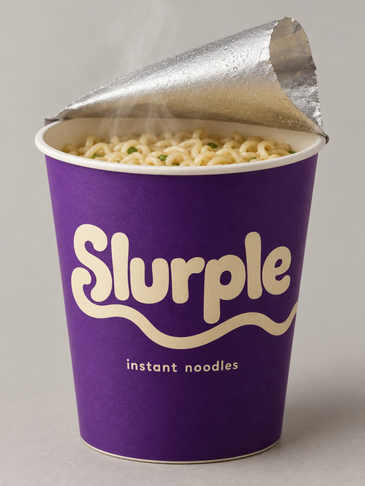

# CGI Ad Generator for Claude Code

<table>
<tr><th>Product photo</th><th>Opening still</th><th>Final still</th></tr>
<tr>
<td></td>
<td></td>
<td></td>
</tr>
</table>

Click the ten frames below to play the 5 second ad:

[](https://cdn.wireflow.ai/a9ae99b0-e188-11f1-8add-bdc2edf59049.mp4)

*Made with this skill on 16 Nov 2026: two GPT Image 2.5 Sunburst Edit stills and a 5 second 9:16 Seedance 2.5 shot with sound, 174 credits in all. Slurple is a made-up brand. The inputs, the receipt, what we checked and what went wrong are in [examples](examples/EXAMPLES.md).*

This CGI ad generator makes the kind of ad where a brand's product turns up giant in a real street and something impossible happens to it, filmed as if on a phone. Tell Claude what the product is and the idea in your own words ("our noodle cup, huge, steaming up a street in Naples"). Claude plans it with a set of rules for size, light and camera, so the product looks like it is standing there and not pasted on, and writes the opening frame, the final frame and the action. It shows you the plan and the credit cost, and once you say yes a Wireflow app makes both stills and a 5 second Seedance 2.5 video with sound that runs from one to the other.

Without a Wireflow connection you still get the plan sheet and all three prompts to use in any image and video tool.

## Try it

```text
Make a CGI ad for my coffee bag: https://example.com/coffee-bag.jpg
I'm thinking the bag is huge on a rainy street in Melbourne and pours
beans down the tram tracks. Vertical, for Instagram.
```

Also triggered by: "fake out of home ad", "FOOH ad", "giant product in a city", "3D street ad", "CGI product video".

## How to install

```text
/plugin marketplace add wireflowINC/skills
/plugin install wireflow-skills@wireflow
```

The plugin brings the Wireflow skills and the connector. Run `/mcp` → `wireflow` and sign in.

To add just this skill: `npx skills add wireflowINC/skills --skill cgi-ad-generator`, or copy `skills/cgi-ad-generator` into `~/.claude/skills/`. Then connect Wireflow with `claude mcp add --transport http wireflow https://www.wireflow.ai/api/mcp` (in Claude.ai and Desktop, add a custom connector with the same URL).

## Works with

- **Claude Code**: the main target. Install the plugin or use the skills CLI.
- **Claude.ai and Claude Desktop**: connect Wireflow as a custom connector. Nothing gets saved to disk there, so you get the links to the stills and the video.
- **Cursor, Codex and other agents that read `SKILL.md`**: the skills CLI can install it there, and rendering needs the agent connected to the Wireflow MCP server. We have not tested those agents ourselves.

## Credits

| Step | Credits |
|---|---|
| Idea, plan and prompts | 0 |
| One ad: 2 stills and a 5 second video with sound | About 175 (20 per still, 27 a second for Seedance 2.5) |
| A retake | The same again, only after your yes |

You can build and browse on Wireflow's Free plan, but Seedance 2.5 and the stills need a paid plan, which starts at US$24 a month.

## What it will not do

- Copy another brand's ad, logo or campaign, or put a real person's face in the shot.
- Pass the ad off as a real event. Use your platform's AI or CGI label where it asks for one.
- Promise a perfect first take. Seedance can still bend a label or run an action differently from the prompt, so Claude checks the stills and the clip and names anything that went wrong.
- Make a long multi-shot ad in one go. Each run is one 5 second shot, and you can join several in an editor.

## Data

- Your product photo URL and the three prompts go to Wireflow as you, through the Wireflow MCP connector (`run_app`).
- The stills and the MP4 download from `cdn.wireflow.ai` into `./wireflow-outputs/`.

## FAQ

### How much does a CGI ad cost with this skill?

About 175 Wireflow credits for one 5 second ad: 20 for each of the two stills and 27 a second for the Seedance 2.5 video. Planning and writing the prompts costs nothing, and Claude quotes the price and waits for your yes before anything runs.

### Do I need a Wireflow account?

To render, yes, with credits on a paid plan, connected through the Wireflow MCP connector. Without one you still get the plan and the prompts.

### Which models does it use?

GPT Image 2.5 Sunburst Edit puts your product into the street for the opening still and makes the final still from it. Seedance 2.5 then makes the 9:16 video at 720p with its own sound, starting on the first still and ending on the second.

### Where do the files go?

Into `./wireflow-outputs/<date>/cgi-ads/`: the opening still, the final still and the MP4, named after the idea, with the CDN links in Claude's report.

### Is it a real 3D render?

No. The CGI look comes from AI image and video models, and nothing is modelled in 3D. The rules in `reference/fooh-rules.md` are what keep the product looking like it stands in the street.

## In this folder

- `SKILL.md`: the steps Claude follows.
- `reference/fooh-rules.md`: the rules, the plan sheet and how to write the three prompts.
- `examples/`: the real run, with the inputs, both stills, video frames and the receipt.

Built on the [Wireflow AI video workflow](https://www.wireflow.ai/features/ai-video-workflow?ref=skill-cgi-ad-generator&utm_source=github&utm_medium=skill&utm_campaign=cgi-ad-generator). Connector guide: [Wireflow MCP docs](https://www.wireflow.ai/docs/mcp?ref=skill-cgi-ad-generator&utm_source=github&utm_medium=skill&utm_campaign=cgi-ad-generator). MIT licensed, and renders use your Wireflow credits.
