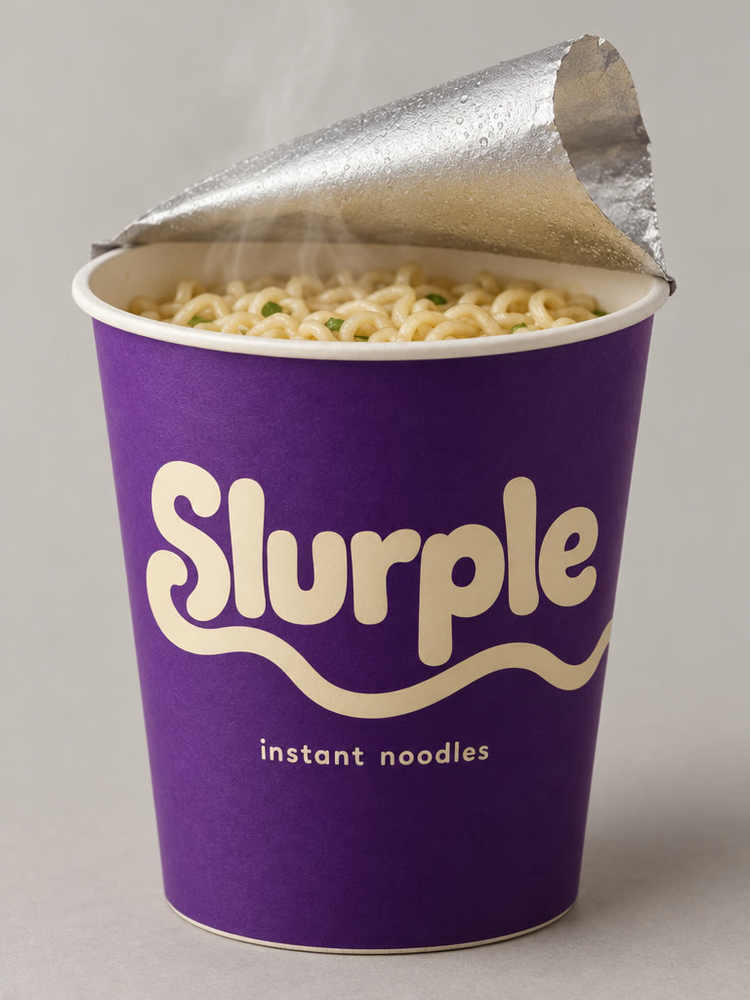

# Real run

One CGI ad made by this skill's Wireflow app (`skill-cgi-ad-generator`) on 16 November 2026: GPT Image 2.5 Sunburst Edit made the opening still from the product photo and the final still from the opening still, then Seedance 2.5 made a 5 second 9:16 shot with sound from one to the other. The images here are downscaled, and the originals are on the Wireflow CDN. Slurple is a made-up noodle brand.

## Product photo

https://cdn.wireflow.ai/openai-image-4fde439b-2f42-4a23-89be-ce1d2b32afe1.png

## The idea

A house-sized noodle cup steams up a whole street in Naples, and the steam blows the washing off the lines.

## Inputs

- `opening_frame`: A narrow shaded street in the Spanish Quarter of Naples on an overcast morning, washing lines with white sheets and shirts strung between the balconies overhead, scooters parked along one wall, worn grey paving. The giant cup stands upright in the middle of the street about 25 m from the camera, 4.4 m tall, two and a half times the height of the people near it, a few faint wisps of steam above its open top. A man in a white apron stands beside its base looking up at it. In the foreground a woman with a shopping bag walks across the street from left to right, her body overlapping the lower left edge of the cup.
- `final_frame`: A thick white cloud of steam has poured out of the open top of the cup and risen up through the washing lines, and the hanging sheets and shirts billow outward like sails in it. The man in the white apron has stepped back and waves the steam away from his face. The woman with the shopping bag has stopped near the right edge of the frame and looks up. The cup itself has not moved.
- `what_happens`: At 0.0s a few faint wisps of steam curl from the top of the giant Slurple cup. By 1.5s the steam thickens and starts rolling upward. At about 2.5s a big white cloud of steam surges up into the washing lines and the hanging sheets and shirts billow outward like sails. The woman with the shopping bag slows and looks up, and the man by the cup steps back and waves the steam away. From 3.5s to 5s the shot holds on the billowing laundry and the drifting steam. Sound: a quiet street, a soft hiss of steam that swells to a whoosh, sheets flapping.

## Outputs

| Output | Original |
|---|---|
| Opening still, 1152x2048 PNG | https://cdn.wireflow.ai/openai-image-6be35d28-7ccd-428d-be48-9fee48f30148.png |
| Final still, 1152x2048 PNG | https://cdn.wireflow.ai/openai-image-1f6272b2-467f-44a3-8b14-7425d56555f1.png |
| The ad, 720x1280 MP4, 5.04 s, H.264 with AAC sound | https://cdn.wireflow.ai/a9ae99b0-e188-11f1-8add-bdc2edf59049.mp4 |

 

Ten frames across the clip, two a second:

## Receipt

- Execution: `cb834c44-43fe-443c-97ba-4684a7bab601`, COMPLETED, about 4 minutes 40 seconds end to end.
- Credits: 174, from Wireflow's credit history: two GPT Image 2.5 Sunburst Edit charges of 20 and one Seedance 2.5 charge of 135 for 5 seconds, matched to this run's node start times, then a 1 credit adjustment back when the video finished. The account balance fell 442 over the run because another job was running on the same account, so the balance drop is not this run's cost.
- The run used the Wireflow Apps API (`POST /api/v1/apps/skill-cgi-ad-generator/execute`), the same code path as the MCP `run_app` tool.

## What we checked

- Label: "Slurple" and "instant noodles" are spelled right in both stills and in every frame we pulled.
- Size: the cup stands about two and a half times the height of the man in the white apron, as planned.
- Camera: a phone at eye level, and the inside of the cup cannot be seen.
- Timing: the cup is in shot at 0.0 s, steam is visible by about 1.75 s, the big surge lands around 2.5 to 3 s, and the clip plays forwards from the opening still to the final still.
- Sound: there is an AAC track (mean -24.5 dB). Nobody has listened to it yet.

## What went wrong

- The man in the white apron is missing from the frames around 3 s and is back for the last frame.
- The giant cup lost the curled foil lid from the product photo.
- The sheets fly off the lines instead of billowing in place, which is stranger than the prompt asked for.
- The woman crosses in front of the cup's lower left edge only for a moment, so for most of the shot nothing is in front of it.
